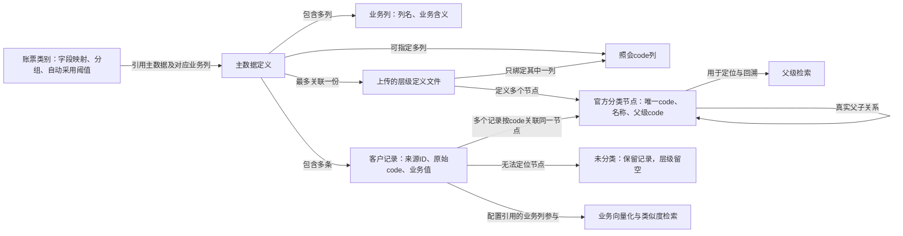
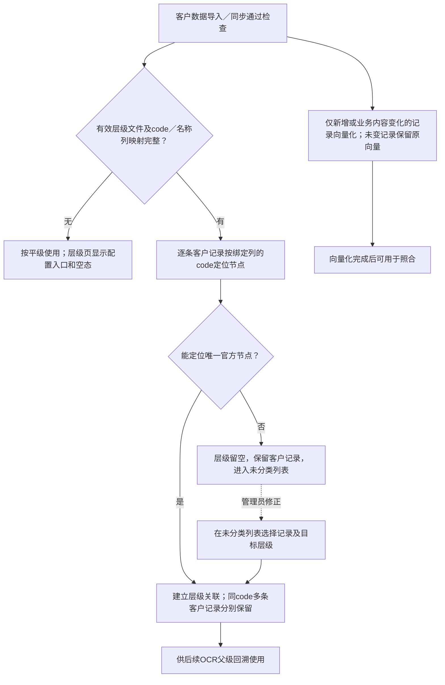
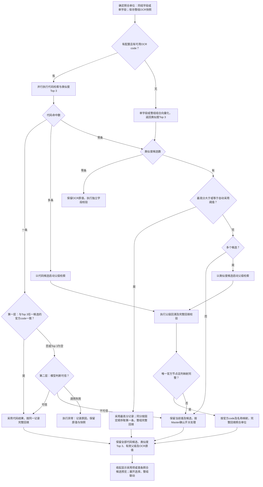
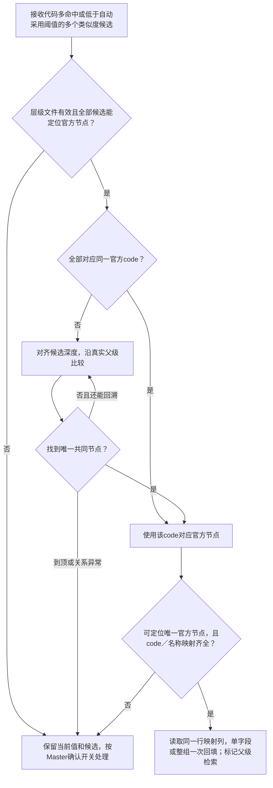

# NeosAI 日本保险 IDP — 产品需求文档（PRD）

## 第 1 章｜文档基础与范围

### 1.1 背景与目标

本期将SFDC主数据定期同步到IDP，并扩展层级回溯、OCR确认、二维码取值及模型配置。ICD-10伤病主数据为首个应用场景，其他主数据复用通用能力。

目标：减少人工维护和逐项核对，无法自动确定的照合结果交由经办人确认。

### 1.2 范围与里程碑

| 模块 | 本期范围 |
| --- | --- |
| 主数据核对／API 更新 | SFDC 或其他外部系统主数据每天固定时刻自动同步及手动更新、差异处理、失败记录处理及结果快照 |
| 主数据树形结构与回溯 | 通用层级、ICD 导入层级判定、配置及自动照合判定与回溯规则 |
| OCR 主数据匹配确认 | 自动替换后的字段展示、原文核对、已有候选选择及人工修正 |
| 主数据容量扩展 | 客户记录上限100,000行，官方分类独立管理 |
| 二维码扫描 | 扩展现有 QR code 后处理规则，支持分隔符与序号取值 |
| OCR模型配置 | OCR 主模型与验证模型按模板组合，在模型设定绑定对象账票并指定兜底模板 |

本文记录三期增量，其余沿用现有产品。

本期通过外部连接读取主数据，优先接入客户SFDC，其他系统按接口契约扩展。

### 1.3 上下游关系与依赖

| 本期模块 | 上游菜单与数据 | 依赖关系 | 下游使用 |
| --- | --- | --- | --- |
| 外部数据同步 | API设定中的外部连接；外部系统提供的对象或数据集、字段和适配器提供的稳定记录标识 | 主数据选定连接、来源并获取字段、保存映射后，才能发起同步；连接可被多张表复用 | 将取得的数据交给主数据更新处理，执行结果写入更新履历 |
| 主数据更新与层级 | 外部同步或手动导入的客户记录；层级关系Tab上传的唯一层级文件 | 按唯一照会code列及文件确定层级；原始记录与分类节点分开保存。业务记录完成向量化后可用于照合；层级关系独立保存和修正 | 供账票类别的Master照合引用；失败记录留在维护页面修正 |
| Master照合配置 | 主数据表、业务列、照会code标记、层级关系和账票级自动采用阈值 | 账票类别第3步选择引用的主数据和照合列；同组多字段按已有分组配置组合 | OCR抽出后执行一次精确查询、类似度校验、阈值判断或回溯，只回填配置引用的列 |
| OCR模板配置 | 用途指派中已保存的OCR模型池及有效模型资源 | 主模型和验证模型取自模型池；保存用途指派时检查正式模板的引用，保存模板时按最新模型池复核 | 按账票选择模板及兜底模板 |
| OCR抽出与模型 | 模型设定中保存的模型模板、对象账票及兜底模板；账票类别第2步的字段、提示词和正解样本 | 按账票匹配OCR模型模板，未指定时使用兜底模板；账票级人工确认规则继续分别维护 | 产生原始抽出值，交给后处理规则和Master照合 |
| OCR抽出确认 | 本次OCR原文、自动照合结果、候选快照及账票级人工确认规则 | 经办人基于本次快照核对、选择候选或修正当前业务值 | 人工修正值优先，保存后的字段继续参与后续处理及导出 |
| 二维码后处理 | 账票中的二维码解码结果；第3步配置的取值方式、分隔符和序号 | 多字段可复用同一解码结果；优先执行第2步复数QR；未启用时才执行后处理QR，多个二维码符合后处理条件时转字段OCR | 将对应片段或OCR抽出值写入配置字段，进入既有校验与确认流程 |

## 第 2 章｜术语与词汇表

| 中文 | 日语/界面 | 定义 |
| --- | --- | --- |
| 主数据 | マスタデータ | 供字段照合使用的标准名称、代码及其他业务属性集合 |
| 照会 code | 照会コード | 在主数据设定的列设置中勾选指定的列，用于 code 精确查询 |
| 照合列 | — | 账票字段在 Master 照合中引用的主数据列，例如伤病名称列 |
| 类似度 Top 3 | — | 仅保留类似度大于 75% 的记录，并按类似度降序最多返回三条 |
| 直接采用阈值 | — | 客户在账票类别人工确认规则中配置的阈值；最高类似度达到该值时，直接采用最高分候选 |
| 上位概念 | — | 主数据节点所属的上级分类，具有可供照合输出的名称和代码 |
| 向上回溯 | — | 将多个候选逐层归到上位概念；收敛为唯一值时，采用该层级的照合列值及代码 |
| OCR模型模板 | OCR抽出テンプレート | 一组主模型、验证模型及对象账票配置；新调用按账票选择 |
| 兜底模板 | 既定テンプレート | 未显式绑定模板的账票默认使用，区别于Master照合中的模型可信兜底 |
| Master确认规则 | マスタ照合結果の確認 | 按账票开启，统一控制未自动确定的Master照合结果是否需要人工确认 |
| 模型可信判断 | — | 对 code 结果未出现在类似度 Top 3 中的情况，结合 OCR 抽出结果、照合结果等信息判断可信或不可信 |

## 第 3 章｜数据结构与状态

### 3.1 主数据结构与关系



箭头表示数据关联。官方记录与关联客户记录同级展示。

| 对象 | 业务内容 | 关系与约束 |
| --- | --- | --- |
| 主数据定义 | 主数据名称、业务列、照会 code 列、层级来源 | 一份主数据最多10个业务列，包含多条客户记录；照会code可选择多列，层级文件仅绑定其中一列；一张主数据最多关联一个层级文件，未关联文件时保持平面 |
| 客户记录 | 来源记录ID、原始 code、伤病名和客户业务属性 | 客户记录按来源ID独立保存，同一code可对应多条记录 |
| 分类节点 | 标准 code、标准名称及父级关系 | ICD 使用上传的官方 2013 分类数据与编码转换规则；分类节点保存官方名称，客户记录保存客户名称 |
| 层级关系 | 客户记录在对应 code 列下关联的分类节点、层级依据及处理状态 | 每张主数据使用同一份层级及照会code列；一个分类节点可关联多条客户记录 |
| 官方父子关系 | 三位、四位、五位或附加细分类之间的关系 | 按层级文件中的真实父子关系定位节点 |
| OCR可用模型池 | 用途指派中保存的OCR模型资源集合 | 模板按模型资源标识引用，主模型和全部验证模型须属于池中有效资源；移出前检查已保存模板的引用 |
| OCR模型模板 | 模板名称、主模型、验证模型、对象账票及兜底标记 | 一份模板可绑定多个账票，一个账票最多显式绑定一份；固定保留一份兜底配置，自定义模板优先 |
| 账票人工确认配置 | 既有人工规则、Master照合结果确认开关及自动采用阈值 | 每张账票独立保存，全部Master照合共用本账票阈值 |
| 普通平面主数据 | 客户数据及列定义 | 保持平面结构 |
| 其他树形主数据 | 导入的节点与层级关系 | 使用层级、code、名称三列模板导入自有分类 |

向量化对象为配置引用的客户业务列；官方节点和关系独立保存。

### 3.2 状态定义

| 状态对象 | 状态 | 含义 |
| --- | --- | --- |
| 客户记录向量化 | 处理中、完成、失败 | 反映业务数据向量化结果 |
| 层级 | 已设置层级、未设置层级 | 独立于向量化状态；管理员在层级关系视图修正 |
| 同步状态标签 | Active、Inactive、Loading | 执行中显示Loading；结束后按启用及配置完整性显示Active或Inactive |
| 同步履历结果 | 同步中、完成、失败 | 点击同步后按钮显示同步中，标题状态标签显示Loading，并禁用重复提交；完成或失败后恢复按钮及Active／Inactive标签；失败保留正式数据 |

## 第 4 章｜用户交互流程

本章从配置管理员与经办人视角，说明主数据从准备到照合确认的使用过程。检索判断、阈值和异常处理在功能详细说明中展开。

### 4.1 三个操作入口

| 入口 | 谁常用 | 用户要做什么 |
| --- | --- | --- |
| 主数据设定 | 配置管理员 | 导入或同步客户数据，维护照会代码列、层级文件与未分类记录 |
| 账票类别设定 | 配置管理员 | 配置照合列、字段分组、人工确认规则及自动采用阈值 |
| 我的任务 · OCR抽出确认 | 经办人 | 查看照合结果，选择候选、修正内容并办结待办 |

原则：主数据设定准备可检索的数据；账票类别设定决定如何使用；经办人在我的任务处理需要确认的结果。

### 4.2 故事一：准备可用于照合的主数据

角色：配置管理员  
目标：将客户业务记录接入系统，并维护可供回溯的层级关系。

```text
导入客户记录／配置外部来源 → 完成向量化 → 上传层级文件 → 查看分类结果 → 处理未分类记录 → 供照合使用
```

1. 准备数据：导入客户业务记录，或选择外部连接、来源对象并获取字段，完成列映射。
2. 准备检索：客户业务记录完成向量化后参与类似度检索。
3. 关联层级：选择照会代码列并上传层级文件，客户记录按代码关联官方节点；同代码的多条客户记录分别保留。
4. 检查结果：在分类树查看官方记录及关联客户记录；无法确定层级的记录进入未分类列表，由管理员集中维护。
5. 持续更新：系统每天日本时间03:00检查外部来源，也支持手动同步；以来源完整数据覆盖更新，仅对有变化的记录重新向量化。未上传层级文件时按平级使用。

### 4.3 故事二：为账票配置照合规则

角色：配置管理员  
目标：让不同账票使用正确的主数据、回填字段和自动采用标准。

```text
选择账票类别 → 配置主数据与照合列 → 设置单字段／同组匹配 → 设置确认规则及阈值 → 保存配置
```

1. 选择数据：为抽出字段指定主数据及对应列，确定照合后回填的业务值。
2. 配置分组：独立字段单独检索；金融机关名与支店名等关联字段可设为同组，组合检索并一起回填。
3. 设置采用标准：在人工确认规则中配置自动采用阈值，并决定是否启用主数据照合结果确认提醒。
4. 保存使用：后续任务按账票配置执行照合；同组字段共用组合类似度和采用判断。

### 4.4 故事三：自动照合并采用结果

角色：经办人  
目标：系统自动完成有依据的回填，仅将无法确定的结果交给人工。

```text
OCR抽出 → 代码检索与类似度检索 → 校验／层级回溯 → 自动采用或保留原值 → 进入确认任务
```

1. 执行检索：配置照会代码列时，同时进行代码检索和类似度检索；没有配置时执行类似度检索。
2. 判断结果：代码唯一命中仍需经过正确性校验；类似度结果按自动采用标准判断。出现多个候选时，符合条件的结果可通过层级回溯收敛。
3. 回填结果：系统确定可采用的记录后回填对应业务值；同组字段从同一条记录一起回填。
4. 保留待确认项：有候选但无法自动确定时保留当前值及候选，按配置提示人工确认；无候选时保留OCR原值，其他字段校验独立执行。

### 4.5 故事四：确认候选并办结任务

角色：经办人  
目标：了解系统提供的候选，修正不确定结果并完成处理。

```text
我的任务 → 查看当前值与照合候选 → 选择／修正／恢复原值 → 确认并保存 → 办结任务
```

1. 查看结果：进入OCR抽出确认，检查当前业务值、检索标签及需要确认的字段；候选区首行展示已采用项或首条预览，当前输入框显示实际业务值。
2. 选择候选：展开列表查看代码检索、类似度检索、父级检索结果及OCR原值；已采用项置顶并标注自动采用。
3. 修正内容：选择正确候选回填，也可直接编辑当前值；直接编辑沿用本次候选快照。
4. 处理同组字段：候选以组合形式展示，选择后一起回填；恢复OCR原值时也按组恢复。
5. 完成任务：按既有保存、确认和办结流程提交，工作流继续执行。

## 第 5 章｜全量功能清单

| 编号 | 功能名 | 一句话 | 菜单/路由 | 配置/执行 | 本期详写 Y/N | 原型状态 |
| --- | --- | --- | --- | --- | --- | --- |
| 01 | 主数据核对／API 更新 | 外部系统每天固定时刻自动同步及手动导入，按变化更新并记录异常 | 主数据设定及更新入口 | 配置/更新 | Y | 完整菜单交互草稿 |
| 02 | 主数据树形结构与回溯 | 按 code 列关联文件，树形展示与修正，OCR 按规则回溯 | 主数据设定／OCR 自动照合 | 配置/自动执行 | Y | 单文件上传、树形及未分类修正可交互；算法需联调 |
| 03 | OCR 主数据匹配确认 | 自动值直接填入、原文可核验、人工修正优先 | 我的任务→OCR 抽出确认 | 人工处理 | Y | 双区域展示可交互 |
| 04 | 主数据容量扩展 | 客户记录上限扩展至十万行 | 主数据设定 | 配置/数据维护 | Y | 数量规则已定 |
| 05 | 二维码扫描 | 复数QR优先，未启用时后处理按全文或分隔符取值 | 账票类别设定第 3 步 | 配置/执行 | Y | 两行配置可交互，真实扫描需联调 |
| 06 | OCR模型配置 | 按模板维护OCR主模型、验证模型、对象账票及兜底模板 | 模型设定→用途指派／OCR模板 | 配置 | Y | OCR模型池、模型模板及账票绑定可交互 |

## 第 6 章｜功能详细说明

各页面与原型一一对应，说明范围如下。

| 页面 | 说明范围 |
| --- | --- |
| 主数据总览与层级关系 | 业务记录、分类树、未分类管理与容量 |
| 主数据列设置 | 列定义与照会code标记 |
| API同步配置 | 来源对象、字段映射及覆盖更新 |
| 更新履历 | 结果、筛选与分页 |
| 外部数据连接 | 连接维护、认证与测试 |
| OCR抽出确认 | 三种检索候选、自动采用与人工确认 |
| 账票后处理规则 | 字段映射、分组与二维码 |
| 账票人工确认规则 | 提醒条件与自动采用阈值 |
| 模型设定 | 用途指派与账票模型配置 |

### 6.01 主数据核对／API 更新

#### 范围说明

每天固定时刻获取外部主数据，与手动导入统一采用覆盖更新。同步到IDP后使用本地照合，接口协议按来源系统资料确定。

#### 功能点

1. 自动同步与手动XLSX／CSV导入均覆盖更新客户记录，官方层级文件独立维护。
2. 同一主数据串行更新，共用完整性检查、差异比对、层级处理及按需向量化。
3. 手动修改可能被后续同步覆盖，入口提示「手动更新的数据可能被下一次同步覆盖」；长期人工修正单独保存。

#### 外部系统来源绑定与自动执行

API设定包含地址、密钥管理及外部数据联动。外部连接可被多张主数据复用。


| 连接与字段配置 | 规则 |
| --- | --- |
| 连接管理 | 新增、编辑、删除、连接测试；列表含序号、名称、地址、创建时间、创建者、状态、操作 |
| 连接状态 | 当前配置测试成功为有效；未测试或失败为无效。测试按钮加载、防重复提交；参数修改后重测，取消或失败保留原配置 |
| 来源与字段 | 展示业务标签，保存API名；用户从对象列表选择来源。实际字段由接口获取，客户Excel仅作业务参考 |
| 配置交互 | 连接、来源、获取字段同一行。字段由用户点击获取；切换连接清空来源并重载列表，切换来源保留只读字段快照，获取成功后才能保存 |
| 字段映射 | 获取字段读取元数据；同步全量读取记录并写入映射列。至少映射一列，目标列唯一，最多映射到10个Master业务列；已选目标列禁选，保存时复核并拦截重复 |
| 同步元数据 | 来源字段列表包含Id，默认未映射，客户可按需选择Master业务列。同步记录中映射自Id的单元格只读，由同步更新；其他业务列照常编辑。保存时复核来源Id，覆盖导入须保留已有同步记录的来源Id及身份，异常时阻止提交。系统独立保存来源ID用于同步识别。接口返回的更新时间字段由适配器自动保存；同code记录按ID分别保留，缺少稳定ID时确认身份方案 |
| 数据获取方式 | 使用SFDC标准REST查询接口，按返回的下一批地址续取，直到完成标记为真。默认请求每批2,000条，实际条数以返回结果为准；收到完成标记后统一覆盖更新 |
| 加载与异常 | 加载显示进度，失败保留原配置；空对象列表提示检查权限。迟到响应按连接、对象、请求次序丢弃，保存时复核访问权限 |

| 同步执行 | 规则 |
| --- | --- |
| 自动执行 | 每天日本时间03:00（北京时间02:00），系统固定；全量获取成功后覆盖更新，按来源ID和业务内容判断变化 |
| 手动执行 | 当前表右上角同步按钮；执行中加载、防重复提交，结束写履历并保持当前页。演示也显示同步中 |
| 启用与暂停 | 暂停仅停止后续自动计划，保留配置与数据，已开始任务继续执行；恢复后等待下一次计划，手动维护始终可用 |
| 页面入口 | 右上角为启用开关、同步按钮、三点菜单；菜单包含更新履历和设置 |

| 更新履历 | 规则 |
| --- | --- |
| 展示 | 右侧抽屉，开始时间倒序；列为开始时间、状态、耗时、执行方法、失败原因。执行方法为自动／手动；未完成耗时、成功记录的失败原因显示占位 |
| 筛选 | 状态、执行方法用多选下拉，组合日期范围并可重置；筛选栏铺满，日期占剩余宽度 |
| 分页与排序 | 默认10条，可选10／20／50条，显示总数、页码、跳页；筛选、页大小、排序变化回第一页，排序覆盖全部筛选结果 |

界面文案：実行方法（执行方法）、自動（自动）、手動（手动）、接続（连接）、取得元データ（来源对象）、フィールドを取得（获取字段）、取得元フィールド（来源字段）、マスタの列名（主数据列名）、連携しない（不映射）、同期（同步）、同期中（同步中）、更新履歴（更新履历）、失敗理由（失败原因）。

#### SFDC标准接口依据

以下为官方已明确的能力；客户环境与业务口径另行联调确认。

| 项目 | 已确定的机制与设计依据 |
| --- | --- |
| 对象与字段 | [对象列表](https://developer.salesforce.com/docs/platform/api-rest/guide/resources-describeglobal.html)返回可用标准／自定义对象；筛选可查询对象，再通过[对象描述](https://developer.salesforce.com/docs/platform/api-rest/guide/resources-sobject-describe.html)取得字段元数据。展示标签、保存API名，字段获取仅读取元数据 |
| 分批获取 | [标准查询](https://developer.salesforce.com/docs/platform/api-rest/guide/resources-query.html)返回总数、完成标记和下一批地址；[每批请求条数](https://developer.salesforce.com/docs/platform/api-rest/guide/headers-queryoptions.html)默认2,000，可设200～2,000，实际条数以响应为准 |
| 记录身份 | 标准业务记录使用[来源记录ID](https://help.salesforce.com/s/articleView?id=000385008&language=en_US&type=1)区分；同code多条记录按来源ID分别保留 |
| 更新时间 | [最后修改时间与系统修改时间](https://help.salesforce.com/s/articleView?id=000336532&language=en_US&type=1)含义不同；后者还包含部分系统自动更新，官方建议用于同步变更检测。本期按计划执行全量覆盖，更新时间用于记录与展示 |
| 令牌续期 | [客户端凭据流程](https://developer.salesforce.com/blogs/2024/02/invoke-rest-apis-with-the-salesforce-integration-user-and-oauth-client-credentials)以运行用户身份访问；访问令牌过期后由后端用客户端凭据重新申请 |
| 删除记录 | [包含删除记录的查询](https://developer.salesforce.com/docs/platform/api-rest/guide/resources-queryall.html)可取得尚未永久清除的软删除记录；普通查询返回有效记录。覆盖更新以完整、有效且权限核验通过的数据集判定删除 |
| 接口配额 | [调用限制](https://developer.salesforce.com/docs/platform/salesforce-app-limits-cheatsheet/guide/salesforce-app-limits-platform-api.html)受组织许可及使用量影响，可读响应配额信息；[配额查询](https://developer.salesforce.com/docs/platform/api-rest/guide/resources-limits.html)另需相应权限。达到限制时按获取失败处理，保留正式数据 |

#### SFDC认证与连接测试

SFDC使用OAuth Client Credentials，以客户指定的运行用户访问；后端按实例地址取得令牌。

| 配置项 | 规则 |
| --- | --- |
| 连接器与认证方式 | 本期使用Salesforce及OAuth客户端凭据认证，默认选中 |
| 编辑字段 | 名称、地址、客户端ID、客户端密钥；新增密钥必填，编辑留空保留原密钥 |
| 密钥显示 | 密码输入框支持显示／隐藏本次输入，已保存密钥保持脱敏 |
| 测试与保存 | 修改参数后重测，通过后才可保存；失败或取消保留原配置，记录修改人和时间 |
| 权限验证 | 测试仅验证认证与接口可达性；对象、字段、业务记录的读取权限分别校验 |
| 令牌与异常 | 后端安全保存凭据；401时重新申请令牌并重试一次，仍失败则终止同步并保留正式数据。认证、权限和网络错误分别反馈 |

原型使用演示参数模拟认证，正式接入由后端处理凭据。

参考：[客户提供的认证文档](https://help.salesforce.com/s/articleView?id=xcloud.remoteaccess_oauth_client_credentials_flow.htm&type=5)、[官方客户端凭据说明](https://developer.salesforce.com/blogs/2024/02/invoke-rest-apis-with-the-salesforce-integration-user-and-oauth-client-credentials)。

#### 每次更新的处理顺序

1. 完整获取全部来源数据；分页缺失、零条、来源ID异常或客户记录超限时整批失败。
2. 按来源ID区分新增、修改、未变、删除；同code的不同记录分别保留。完整有效数据集之外的已删除记录移除。
3. 未变记录保留层级及向量；新增、业务内容变化的记录更新层级并向量化。向量化失败时，新增记录保持失败状态，修改记录继续使用正式旧版。
4. 层级无法确定时保留业务记录，进入未分类管理，业务向量化照常执行。
5. 写入履历及失败原因。官方层级独立保存；已产生的OCR照合结果使用当次快照。

#### 页面与入口

| 页面 | 入口 | 使用者 |
| --- | --- | --- |
| 外部系统连接 | API 设定→外部数据联动 | 管理员 |
| 同步配置 | 主数据设定→选中主数据→三点菜单→设置 | 管理员，首次配置后自动使用 |
| 手动更新 | 主数据设定→现有批量导入 | 管理员 |
| 更新履歴（更新履历） | 主数据设定→选中主数据→三点菜单→更新履历→右侧抽屉 | 管理员 |
| 更新失败详情 | 更新履历抽屉→失败原因列 | 管理员 |

标题区显示主数据名、同步状态与操作；其下为视图页签，再显示当前视图工具栏，纵向间距16px。

下次同步按统一每日固定时刻计算，使用日本时间。执行中显示Loading；任务结束后，已启用且来源和映射完整时恢复Active，否则Inactive。Active／Inactive表示计划状态，连接状态及同步结果分别展示。

#### 按钮与启用条件

| 按钮 | 场景 | 启用条件 | 点击后 |
| --- | --- | --- | --- |
| 接続を追加（新增连接） | API 设定的外部数据联动 | 有维护权限 | 打开连接表单，保存后供各主数据选择 |
| 編集（编辑连接） | 外部数据联动连接表 | 有维护权限 | 修改连接信息，保持各主数据原有引用关系 |
| 削除（删除连接） | 外部数据联动连接表 | 未被主数据同步配置引用 | 确认后删除；被引用时提示先修改主数据的连接选择 |
| 有効（启用开关） | 主数据标题区 | 已选中主数据 | 即时保存当前表启用／暂停状态，暂停期间保持人工编辑可用 |
| 同期（同步） | 主数据标题区 | 本表已启用且来源、字段映射完整，当前未在同步 | 按钮显示同步中、状态标签显示Loading，使用已保存配置发起一次同步，结束后提示结果并记录履历，保持当前页 |
| 設定（设置） | 标题区三点菜单 | 已选中主数据 | 打开本表同步配置弹窗 |
| 更新履歴（更新履历） | 标题区三点菜单 | 已选中主数据 | 打开右侧抽屉，保留主表查询、分页及编辑内容 |
| 保存（保存同步配置） | 同步配置弹窗 | 已获取字段，来源和映射校验通过 | 保存本表绑定和映射，使用统一每日固定执行时间 |
| フィールドを取得（获取字段） | 同步配置 | 已选连接和来源对象，当前无获取请求 | 显示加载状态，成功返回后更新字段快照及映射表 |
| 接続テスト（连接测试） | 外部数据联动 | 有权限，当前无测试请求 | 显示测试中，结束后反馈可达性结果 |
| 一括インポート（批量导入） | 手动更新 | 已选中主数据，沿用既有入口条件 | 选择文件并执行覆盖更新 |
| OK（确认导入） | 手动更新 | 文件通过既有检查 | 与自动更新串行执行，按已保存配置核对层级 |

#### 异常与边界

| 场景 | 条件 | 用户提示/处理 |
| --- | --- | --- |
| 来源绑定失效 | 来源对象不可访问、记录 ID 或已映射字段不存在 | 本批失败，保留正式数据，提示失效对象或字段及原因 |
| 获取不完整 | 分页缺失、超时或数据截断 | 提示「データの取得が完了していないため、更新しませんでした（本次数据获取不完整，未更新）」，保留原正式数据 |
| 全量零条 | 完整获取确认返回零条 | 视为异常，保留正式数据；更新履历记录失败。提示「取得データが0件のため、更新しませんでした（来源数据为零条，未执行更新）」 |
| 单条层级异常 | 无法确定层级属性 | 层级关系视图保留未设置层级和原因，业务向量化独立执行 |
| 并发更新 | 同一主数据已有更新任务 | 串行处理；同步中禁用重复发起，已开始任务执行至结束 |
| 候选对应记录被更新或删除 | OCR 结果已经产生 | 沿用该次结果及候选快照 |

#### 待确认

| 编号 | 问题 | 影响范围 | 阻塞级别 | 默认假设 |
| --- | --- | --- | --- | --- |
| P-009 | 客户实例与凭据、运行用户的数据可见范围、目标对象和字段业务含义及删除范围 | 外部连接及主数据更新 | 开发联调前确认 | 标准对象按来源记录ID区分；对象及字段API名自动获取。客户确认授权覆盖所需全部记录，防止将权限缩小造成的不可见误判为来源删除 |
| P-016 | 标准REST查询适用性、客户实际配额及批量读取性能 | API数据获取及覆盖更新 | 开发联调前确认 | 分批续取机制已明确；取得客户授权后验证对象支持、完整读取耗时及配额，若需改用批量查询接口，由开发评估读取方案 |

### 6.02 主数据树形结构与回溯

#### 范围说明

维护客户业务记录、照会code列和独立层级关系；支持平面主数据、ICD官方分类及其他树形主数据。照合阈值在账票类别配置。

#### 导入层级判定与可用条件

客户记录按来源ID保留，使用层级文件绑定的code列定位官方节点；同code或同名称的记录按来源ID分别保留。新增、业务内容变化的记录重新向量化，未变记录保持原状态；层级属性独立处理。

| 触发条件 | 处理与结果 |
| --- | --- |
| 导入 ICD 客户记录 | 按官方2013编码、显示编码及附加细分类规则定位节点 |
| code能定位 | 同code的全部客户记录关联同一官方节点，客户名称分别保留 |
| code无法定位或关系冲突 | 层级留空，保留记录及原因，进入未分类列表；业务向量化结果独立记录 |
| 管理员调整层级或父级 | 校验目标节点存在、父子关系无环且父级与自身不同；成功后立即更新层级关联 |
| OCR 运行时需要回溯但候选缺少层级 | 转入Master照合结果确认；code校验通过或类似度达标时仍可直接采用 |
| 业务向量化失败 | 修改记录沿用正式旧版，新增记录保持失败状态，层级独立维护 |

层级文件及层级变更只影响之后发起的照合。已有照合结果和层级路径使用当次快照。

#### 功能点

1. 列设置用复选框选择照会code，可选多列；层级文件只绑定其中一个code列及一个名称列，其他code列仍可检索。
2. 层级关系页独立上传、下载模板；每张主数据仅保留一份文件。上传弹窗统一选择code列、名称列及文件，点击保存校验并提交；成功替换文件、节点及人工关联，取消或失败保留原配置。
3. 模板含层级、code、名称三列；支持任意层数，父节点在前，code唯一，上一级必须存在，按深度和行序建树。
4. 删除绑定列或取消其照会code标记时解除关联；列重命名或勾选其他列保留绑定。父子关系取自层级文件。

无有效层级文件时按平级使用；层级关系页仍显示上传入口。名称照合列由账票类别配置。

界面文案：階層定義ファイル（层级定义文件）、階層テンプレート（层级模板）、照会コード（照会code）、再ベクトル化（再向量化）。

#### 导入层级流程



重导文件或切换绑定列成功后，重新判定层级并清除旧人工关联；文件校验失败保留原正式配置。图中导入／同步使用已保存的层级配置。

#### 页面与入口

| 页面 | 入口 | 角色 |
| --- | --- | --- |
| 主数据维护 | 业务规则配置→主数据设定 | 管理员 |
| 列設定（列设置） | 选中主数据→列设置 | 管理员 |
| 导入 | 选中主数据→既有批量导入入口 | 管理员 |
| 层级关系 | 主数据设定→选中主数据→层级关系视图 | 管理员 |

#### 按钮与启用条件

| 按钮 | 适用场景 | 启用条件 | 点击后 |
| --- | --- | --- | --- |
| 列設定（列设置） | 主数据维护 | 已选中主数据 | 打开列设置，以复选框指定照会代码列，可选多列 |
| 保存（保存列设置） | 列設定（列设置） | 列名非空且唯一，照会code可选多列 | 保存列定义；取消保留原配置，文件上传在层级关系Tab独立执行 |
| 模板下载 | 层级关系Tab工具栏 | 有维护权限 | 下载层级、code、名称三列模板 |
| 上传／重新导入 | 层级关系Tab工具栏 | 存在可选照会code列且未在读取文件 | 打开上传弹窗，选择code列、名称列及XLSX／CSV文件；保存时整体提交文件、映射及关系，取消或失败保留原配置 |
| 展开／折叠全部层级 | 层级树上方 | 存在可见节点 | 单按钮切换树的展开／折叠状态 |
| 设置层级 | 未分类行内；勾选后提供批量入口 | 已上传有效层级文件，目标节点有效 | 选择节点即保存，成功后移入已分类并补齐当前页 |
| 移至未分类 | 已关联的客户记录 | 有维护权限 | 操作成功即解除关联，保留业务记录及向量化状态；失败保留原关联 |
| 一括インポート（批量导入） | 主数据维护 | 沿用既有入口条件 | 进入导入流程；使用该主数据已保存的唯一层级绑定 |
| 向量化状态列标题 | 主数据维护列表 | 列表存在记录 | 首次点击按升序排列，再次点击切换降序；升序失败在前、完成在后，降序相反；表头显示当前方向 |
| 失敗（失败状态） | 业务向量化失败的行 | 向量化状态为失败 | 只读显示原因；层级属性异常在独立视图维护 |

| 主要操作 | 规则 |
| --- | --- |
| 底部操作 | 关闭退出当前主数据；层级操作各自提交，文件变更在弹窗保存 |
| 层级工具栏 | 下载模板、上传／重新上传、代码／名称搜索 |
| 文件删除与替换 | 上传／重新上传弹窗显示当前文件，×移除本次文件；移除后可选择新文件替换，不选新文件则删除。底部统一为保存，一次提交文件及code／名称映射，取消保留原配置。删除需确认清除层级关系、保留业务记录。提交后层级区域显示更新中，成功刷新，失败保留原配置；替换或code映射变化重判归属并清除旧人工关联，仅名称映射变化保留关联 |
| 上传弹窗布局 | code列与名称列并排展示，下方为文件拖拽／点击选择区；选中文件后展示文件名、大小和更换、移除操作；窄屏映射纵向排列 |
| 文件弹窗保存 | 上传或替换时文件、code列及名称列必填，映射列互斥；删除时允许文件为空。校验通过后提交，处理中禁用重复操作 |
| 行内设置层级 | 选择已有目标节点即提交，成功后更新记录归属；已分类记录通过移至未分类后重新设置。失败保留原关联 |
| 离开层级页 | 切页签、切主数据或关闭时保留已提交结果；文件处理中等待完成后离开，弹窗取消保留原配置 |
| 再向量化 | 处理当前主数据全部客户记录；执行中显示处理中及加载，完成后更新结果 |
| 禁用条件 | 无记录、同步或向量化执行中、存在未完成编辑时，禁用再向量化并防止重复提交 |
| 层级配置 | 上传弹窗选择code列和名称列，与唯一层级文件一起提交；code取已勾选照会code的列，名称取其他业务列。切换code重判层级并清除旧人工关联；仅切换名称时保留层级关联及向量 |
| 删除记录 | 层级视图仅维护关系；业务记录在主数据列表删除，删除父级后其下客户记录转入未分类 |

| 页面布局 | 展示要求 |
| --- | --- |
| 外层页签 | 主数据／层级关系常显，位于主数据标题下方、列设置等操作按钮上方，与下方内容左对齐；操作按钮随当前视图显示 |
| 内层切换 | 已分类／未分类共用分段控件及数量，默认已分类；同一行右侧分别显示展开／折叠、设置层级 |
| 分页 | 已分类按最高展示层级的记录计数，每页10个，官方记录和导入的客户记录均各占一个名额；每个最父级及其全部子层级作为一个分页单位。未分类每页10条客户记录。分别保留页码；已分类同时显示本页及当前搜索结果全部分页的末级分类节点数量，翻页更新本页数，统计覆盖折叠节点（按末级官方节点计数），页码仍按最父级数量计算；未分类显示记录总数，均支持页码及跳页；搜索回第一页，记录移动后页码超界时回最后有效页，翻页清空当前页勾选 |
| 内容区域 | 两个视图共用顶部位置、边框、内边距及480px内容高度；树行操作与右侧滚动条保留20px间距 |
| 分类树 | 可折叠、有缩进；同code官方在前、客户紧随且视觉同级，来源标签放在文字后。官方显示模板code及名称，客户显示映射列原值；官方记录及父子关系只读 |
| 搜索 | 仅保留代码／名称搜索；树展示有关联客户记录的节点及必要祖先，目标层级选择仍提供完整分类 |
| 未分类 | 每行直接显示可搜索层级下拉框，选择即保存，成功移出列表并补齐当前页；失败保留原记录。已分类通过移至未分类解除关联。仅勾选后显示批量设置层级入口，选择即提交全部选中记录 |
| 关系变更 | 设置层级或解除关联只更新层级关系，展开／折叠只更新显示状态 |

| 空状态 | 显示与操作 |
| --- | --- |
| code／名称映射不完整或无有效层级文件 | 显示配置入口与空态 |
| 已配置且无未分类记录 | 保留未分类入口，列表显示空态 |
| 无可见树节点 | 禁用展开／折叠按钮 |

界面文案：名称列（名称列）、分類済み（已分类）、すべて展開（展开全部层级）、すべて折りたたむ（折叠全部层级）、公式（官方）、インポート（导入）、未分類（未分类）、階層を設定（设置层级）、設定先の階層（目标层级）。

名称列用于客户记录显示，也确定官方名称对应的主数据列；官方code对应层级code列。回溯只回填账票引用这两列的字段，同组还需其他列时转人工确认。模板采用层级、code、名称三列。

#### 字段与参数规格

| 字段/参数 | 控件 | 必填 | 数据来源与枚举 | 校验与转换 | 下游消费 |
| --- | --- | --- | --- | --- | --- |
| 照会 code | 列设置中的复选框，可选多列或不选 | 否 | 当前主数据列 | 勾选时同时精确查询和类似度检索；未勾选仅做类似度检索；允许多列，层级文件只关联其中一列 | Master 照合 |
| 层级code列 | 单选下拉 | 使用层级时必填 | 当前主数据已勾选照会code的列 | 每份文件仅选一列；按稳定列标识绑定 | 层级定位、官方code回填 |
| 层级名称列 | 单选下拉 | 使用层级时必填 | 当前主数据除层级code列以外的业务列 | 与code列互斥，用户显式选择；改名保留绑定，删除前须更换映射；空值显示空白 | 客户名称展示、官方名称回填 |
| 层级来源 | 层级关系Tab上传的唯一文件与照会code列关联；模板名称与所选主数据名称列对应，账票字段按自己的主数据列映射消费该名称 | 使用外部分类关系时必填 | 普通平面、关联上传的层级定义文件、导入已有层级 | ICD 使用官方 2013 分类及附加规则；模板支持任意层数，按行序和层级深度建立父子关系；每张主数据仅一份文件，关联一个code列及一个名称列；层级绑定列唯一 | 导入层级判定、回溯 |
| 层级关系 | 上传文件生成或数据自带关系 | 树形数据需有确定关系 | 已上传层级定义文件及有效层级，或其他数据导入关系 | ICD父子关系取自层级文件 | 回溯、层级展示 |

#### 列表展示

| 列名或内容 | 含义 | 说明 |
| --- | --- | --- |
| 业务属性列 | 标准名称、代码和客户属性 | 沿用主数据列设置 |
| 树形code与层级修正 | 分类父子关系及对应客户记录 | 独立层级关系视图显示分类树及客户记录的code、未分类列表；管理员在未分类列表选择记录并设置目标层级，保持原业务code及向量 |
| 照会 code 标记 | 标明哪些列用于精确查询 | 列设置复选，可选多列；数据区在列名旁使用既有 code 标记 |
| 向量化状态 | 复用既有列表示该记录本次处理结果 | 仅反映业务向量化，支持表头升降序及失败原因查看 |

状态排序作用于当前主数据的全部查询结果，覆盖全部分页；保留搜索条件，切换排序后回到第一页，同状态记录保持稳定次序。处理中升序排在失败与完成之间，降序反转。

#### 异常与边界

| 场景 | 条件 | 用户提示/处理 |
| --- | --- | --- |
| 保存配置已被他处修改 | 进入页面后正式层级配置发生变化 | 阻止覆盖，提示正式配置已变化；保留草稿，重新加载后核对 |
| 文件读取未完成 | 用户尝试保存或离开层级页 | 阻止保存及离开，提示等待当前处理完成；读取结束可继续 |
| code 无法定位或关系冲突 | code 无唯一对应官方节点，或层级关系异常 | 层级留空并保留记录，提示「階層を特定できません。コードと階層定義を確認してください（无法确定层级，请检查code与层级定义）」；管理员可在未分类列表选择记录并设置层级 |
| 实际向量化失败 | 业务向量生成失败 | 向量化状态显示失败，原因标明「ベクトル化に失敗しました（向量化失败）」及具体错误，与层级判定失败区分；新增版本保持失败，修改记录保留旧版 |
| 层级文件非法 | 表头不符合三列模板、code 重复、节点缺失或层级跳跃 | 提示「階層・code・名称と親子関係を確認してください（请检查层级、code、名称及父子关系）」，保留原文件及关系 |
| 未设置层级记录 | 无法定位对应分类 | 层级字段留空，原记录保留在未分类列表，可选择已有目标节点关联 |
| 手动输入不存在节点 | 输入内容无法唯一定位已有节点 | 阻止保存，提示选择已有层级节点，保留原关联 |

### 6.03 OCR 主数据匹配确认

#### 范围说明

本模块说明 OCR 抽出确认页如何展示和修正字段。自动匹配仍按主数据照合规则执行。

#### 三类阈值的边界

| 名称 | 数值及边界 | 用途 |
| --- | --- | --- |
| Top 3类似度检索门槛 | 固定大于75%，按类似度降序最多保留3条 | 筛选名称检索候选 |
| 自动采用阈值 | 按账票配置，默认90%，须大于75%且不超过100%；大于或等于时达标 | 仅用于类似度分支，最高分达标时采用客户伤病名 |
| OCR抽出置信度阈值 | 当前原型为85%，低于时触发OCR低置信度规则；正式配置沿用既有OCR规则 | 校验原OCR抽出结果 |

Master照合使用类似度分数；模型兜底返回可信／不可信，OCR置信度独立校验。

平面主数据支持code校验及类似度达标采用；需要回溯时按人工确认规则处理。

#### 检索入口

以组或未分组的单字段为照合单位，使用本次OCR原值、账票字段映射及主数据快照。配置照会code时，代码检索与类似度检索并行；未配置或OCR中无可用code时使用类似度检索。查询失败作为执行异常反馈。各类结果均按映射返回业务值，组内各字段取自同一条记录。

#### 代码检索

1. 输入：账票照合单位中对应照会code的OCR值，按已有编码规则查询主数据。
2. 唯一命中先做第一层校验：将该结果关联的官方code与类似度Top 3各候选的官方code比较，任一一致即可采用。平面主数据按既有代码完成同样校验。
3. 第一层未通过（含Top 3为空）再做第二层校验：调用既有模型可信判断。可信则采用，不可信则保留候选并按Master确认开关进入确认；模型调用失败显示执行异常。
4. 多条命中时，全部记录作为父级检索候选；零条命中进入类似度分支。代码结果按两层正确性校验决定采用。
5. 采用后标记代码检索，单字段回填对应业务列，有组则回填同一行的整组列。代码候选仍保留在本次下拉快照中。

例如，代码唯一命中记录A，类似度最高候选为B，但Top 3中另有一条与A的官方code一致，第一层即通过；Top 3均不一致时才进入模型兜底。

#### 类似度检索

1. 单字段使用当前OCR值；同组按配置顺序组合OCR值，与主数据同一行映射列匹配。每个候选只有一个单字段或整组分数。
2. 保留通过Top 3检索门槛的客户记录，同code记录分别保留。候选不足三条时按实际数量展示。
3. 无code结果时，最高分达到自动采用阈值即采用；低于阈值时，单候选待确认，多候选尝试父级回溯。无候选保留OCR原值。
4. 完全同分按来源记录ID升序取第一条；无ID的旧数据按本次快照固定顺序。采用与展示排序一致，使用未舍入分数判定；同分候选仍须达标。

#### 父级检索

1. 入口：代码多条命中，或无代码结果且类似度最高分低于自动采用阈值、存在多个候选。按本次照合单位回溯，有组时整组参与。
2. 先把全部参与候选映射到上传层级文件中的官方code节点。全部已属于同一节点时，直接取该节点；否则先对齐深度，再沿真实父级查找最近的唯一共同节点。
3. 得到唯一父级code后，定位层级文件中的唯一官方节点，按字段映射读取同一行的业务值；只替换配置引用的字段。单字段回填一列，组内字段一次完整回填，标记父级检索。
4. 父级采用条件为真实官方节点唯一收敛且映射完整。缺少层级、关系异常、到顶仍不收敛、官方节点无法确定或缺少组内映射列时，保留当前值及候选，按Master确认开关处理。
5. 官方层级及父子关系用于定位和回溯，未上传层级文件时保持平面结构。

例如，客户两条C694记录分别为不同伤病名，低于自动采用阈值时，两者先关联官方C694并在此收敛，采用该code对应的“毛様体”。候选分别关联C693、C694时，才查找共同上级C69。

#### 执行规则

| 共用规则 | 处理 |
| --- | --- |
| 回填范围 | 仅写入账票配置引用的业务列 |
| 字段最终值 | 自动采用写入当前值；保存与办结以人工修正值为准 |
| 结果快照 | 每个照合单位执行一次，人工操作及后续处理沿用本次快照 |
| 执行异常 | 检索、模型调用失败或超时单独反馈，保留当前值及已有快照 |

界面文案：自動採用（自动采用）、コード検索（代码检索）、類似度検索（类似度检索）、親階層検索（父级检索）、OCR抽出値（OCR原值）。

#### Master照合流程

本图描述自动判定顺序，各类实际检索结果均保留在候选快照中。接口或模型调用失败记录执行异常，并保留原值及已有快照。



#### 父级检索流程



#### 功能点

1. 展示当前业务值和本次检索候选，支持选择、修正、恢复OCR原值及确认。
2. 单字段回填对应列，同组从同一条记录完整回填；保存记录修改与确认进度，办结后继续工作流。

#### 按组照合规则

在账票类别的主数据后处理配置中，将关联字段设为同一组，分别映射同一张主数据的业务列。整组是一次照合及回填单位，整组支持code和类似度检索；未分组时，以单字段为单位执行对应检索和回填。

| 组内检索情况 | 判断与处理 |
| --- | --- |
| 存在code字段 | 组内某字段映射到已勾选的照会code列，且其OCR值可用时，执行该code的精确检索，同时执行整组组合类似度检索 |
| code唯一命中 | 先与整组类似度Top 3候选的关联官方code比对，任一一致即通过；否则调用模型可信兜底。任一层通过后采用该主数据记录，从同一行按映射整组回填 |
| code唯一但校验不通过 | 第一层未通过且模型判断不可信时，保留候选，按人工确认规则处理。模型调用失败显示执行异常 |
| code命中多条 | 一个code列的同一个值可能命中多条客户记录；以这些记录作为整组候选执行父级回溯。回溯成功后仍保留原代码候选 |
| 无可用code或精确检索零命中 | 使用整组组合类似度：按配置顺序组合OCR值，与主数据同一行对应列匹配，得到一个整组分数。最高分达到自动采用阈值即整组采用；同分按固定顺序取第一条。未达标且有多个候选时回溯，只有一条则按人工确认规则处理；无候选保留整组OCR原值 |

父级回溯统一使用主数据绑定层级文件的code列；收敛后按官方节点的code、名称完整回填整组。官方节点异常、映射缺列或层级无法收敛时，整组保留当前值并进入人工确认。

| 同组交互 | 规则 |
| --- | --- |
| 候选与原值 | 按字段配置顺序以“-”连接；各字段展开同一候选快照，选择后按字段映射回填 |
| 恢复原值 | 选择OCR原值，恢复整组首次抽出值，清除采用信息和确认状态 |
| 人工改值 | 修改任一字段时取消整组选中；保留其他字段当前值及本次快照。 |
| 空值 | 保留组内位置并显示空白占位；各字段的必填及范围校验独立执行 |

组合示例：金融机关名“瀬戸”与支店名“瑞穂通”整组类似度92%，阈值90%，采用同一候选“瀬戸信用金庫-瑞穂通支店”，分别回填两个字段。

代码优先示例：手术代码与手术名同组，OCR代码唯一命中记录A，虽然OCR手术名有误、组合最高类似度仅88%（自动采用阈值90%），但Top 3中存在与A关联官方code一致的候选，第一层校验通过，仍从A同一行一起回填手术代码和手术名。原型A12、A13分别对应Top 3校验及模型兜底采用。

界面文案：OCR抽出値（OCR原值）、（空欄）（空白）、マスタ照合結果の確認（主数据照合结果确认）。

#### Master人工确认的分类条件

开启账票“主数据照合结果确认”后，以下未能自动确定的照合结果进入人工确认，界面统一标记“要确认”。单字段按字段判定，同组按整组判定和回填。

| 情况 | 判定规则 |
| --- | --- |
| code唯一命中但校验未通过 | 代码结果关联的官方code与类似度Top 3各候选均不一致，或Top 3为空；随后模型兜底判断不可信 |
| 类似度只有一条候选且未达阈值 | 无code命中，类似度检索仅返回一条有效候选，且分数低于账票自动采用阈值 |
| 需要回溯但缺少有效层级 | code命中多条，或无code命中且多个类似度候选的最高分低于自动采用阈值；此时未配置有效层级文件，或至少一条参与回溯的候选无法关联官方节点 |
| 层级关系异常导致回溯中断 | 回溯路径存在父级缺失、循环或关系冲突，无法继续查找共同官方节点 |
| 回溯到顶仍未收敛 | 参与回溯的候选已到各自真实顶层，仍无法确定唯一共同官方节点 |
| 父级结果无法唯一确定 | 回溯得到的官方code无法定位到唯一有效官方节点 |
| 父级映射不完整 | 已找到唯一官方节点，但code列、名称列映射缺失或失效，或缺少组内配置引用的列，无法按映射完整回填 |

多个类似度候选未达阈值时先执行回溯；成功收敛且映射完整时自动采用。最高分达到阈值时采用最高分记录，同分按来源记录ID升序取第一条，无ID时按本次快照固定顺序。

关闭该确认规则时，未确定结果保留当前值及候选。无照合候选时保留OCR原值，OCR低置信度、必填和范围等规则独立判断。

检索失败、超时或模型兜底调用失败沿用执行异常处理，保留当前值及已有快照供人工处理。

采用或人工选择照合值后，清除原OCR低置信度及模型冲突提醒；恢复OCR值时恢复原始校验。必填、范围等当前值校验始终生效，原OCR分数仅作原文信息保留。

界面文案：要確認（要确认）。

#### 代码候选与父级结果同时存在

同一官方code可关联多条客户记录，父级结果读取该官方节点。

code命中多条且回溯成功时，保留客户代码候选与官方父级结果；选择前者回填客户值，选择后者回填官方值。同组仍须从一行完整回填。

示例：两条code记录＋类似度Top 3＋父级＋OCR原值，共七条。代码候选全部保留，父级选项仅在回溯成功时提供。

各结果必须属于同一次照合快照；按请求及版本丢弃旧响应。

#### 判定示例

| 输入（自动采用阈值90%） | 结果 |
| --- | --- |
| 类似度96%、93%、82%；或90%、86%、81% | 分别采用96%、90%记录 |
| 类似度93%、93%、81% | 2条93%类似度记录人工确认 |
| 只有88%一条；或88%、85%、81% | 前者待确认，后者尝试回溯 |
| 两条客户记录同属C694 | 在官方C694“毛様体”收敛 |
| 候选分属C693、C694 | 查找共同父级C69，采用其官方名称 |

#### 原型场景覆盖

OCR抽出任务TASK-OCR-001提供“自动采用”和“要确认”两页。以下编号与原型字段标题一一对应，默认自动采用阈值90%；全部自动采用项显示标签并置顶，人工选择后清除标签。M8、M9、M13、M14使用边界状态快照，M10、M11使用错误快照。

| 自动采用编号 | 场景 |
| --- | --- |
| A1 | code唯一命中，Top 3代码校验通过 |
| A2 | code唯一命中，模型可信兜底通过 |
| A3 | 类似度最高分超过自动采用阈值 |
| A4 | 类似度最高分等于自动采用阈值 |
| A5 | code多命中，回溯同一官方节点 |
| A6 | 类似度多候选低于阈值，回溯共同父级 |
| A7 | 整组类似度达标，一起回填 |
| A8 | 整组code多命中，父级名称与代码一起回填 |
| A9 | 两条code＋Top 3＋父级＋OCR，共七条 |
| A10 | 单字段最高分达标且并列，固定顺序采用第一条 |
| A11 | 多条均达标，采用最高分 |
| A12 | 整组code唯一命中，Top 3校验通过 |
| A13 | 整组code唯一命中，模型兜底通过 |
| A14 | 整组类似度多候选，回溯官方节点 |
| A15 | 整组最高分达标且并列，固定顺序采用第一条 |
| A16 | 未配置层级，类似度达标仍采用 |
| A17 | 未配置层级，code唯一且校验通过仍采用 |
| A18 | 类似度只有一条候选，达到阈值即采用 |
| A19 | code唯一、Top 3为空，模型可信后采用 |
| A20 | 类似度最高分为100%，正常自动采用 |
| A21 | 父级code下存在多条客户记录，仍采用唯一官方节点的code和名称 |

| 要确认编号 | 场景 |
| --- | --- |
| M1 | 单候选低于自动采用阈值 |
| M2 | 最高分并列但低于阈值，且无层级可回溯 |
| M3 | code唯一，两层校验均未通过 |
| M4 | 多候选低于阈值，未配置层级文件 |
| M5 | 至少一个候选无法关联官方节点 |
| M6 | 到真实顶层仍无共同官方节点 |
| M7 | 整组候选未达阈值且无法完成回溯 |
| M8 | 父级缺少整组映射列，整组待确认 |
| M9 | 层级缺失父级或循环，无法回溯 |
| M10 | 检索接口失败或超时，显示执行异常 |
| M11 | 模型校验调用失败，显示执行异常 |
| M12 | code多命中但没有层级文件 |
| M13 | 父级名称列映射未设置，无法确定回填目标 |
| M14 | 父级名称列映射失效，无法完整回填 |

无候选对照项使用正常OCR置信度并保留原值；达标同分示例为A10／A15。

界面文案：マスタ照合（自動採用）（主数据照合：自动采用）、マスタ照合（要確認）（主数据照合：待确认）。

#### 操作权限与确认边界

| 操作者或场景 | 本期职责 |
| --- | --- |
| 管理员 | 维护主数据列、导入配置及层级属性；在账票类别维护阈值及人工确认规则，查看同步失败原因 |
| OCR 经办人 | 在既有权限范围内查看和修正抽出值、选择本次候选 |
| 主数据层级异常 | 属于层级属性未设置层级，由管理员维护，业务向量化状态独立 |
| OCR 照合人工确认 | code 结果判为不可信、回溯仍不唯一等情况进入既有 OCR 抽出确认 |

#### 页面与入口

| 页面 | 入口 | 角色 |
| --- | --- | --- |
| OCR 抽出确认 | 操作端→我的任务→对应待办 | 有权办理的经办人及管理员 |
| 照合候选 | Master 照合字段下方的照合结果下拉区 | 同上 |
| 原文核对 | 现有候选列表中的OCR原值选项 | 同上 |

#### 按钮与启用条件

| 按钮或操作 | 适用场景 | 启用条件 | 点击后 |
| --- | --- | --- | --- |
| 展开照合候选 | 下方 Master 照合结果区 | 待办可编辑且存在候选 | 展开当前可选候选，在原位置展开，列表包含OCR原值 |
| 单选候选 | 候选列表 | 存在候选且待办可编辑 | 回填该结果中本次配置引用的列 |
| 人工修正业务值 | 当前业务字段 | 待办可编辑 | 将人工修正值作为最终值；分别保存人工修正值与首次OCR快照 |
| 保存（保存） | OCR 抽出确认 | 沿用既有条件 | 保存修正和确认进度，待办保持处理中 |
| 確認・完了（确认、办结） | OCR 抽出确认 | 沿用既有确认与字段校验条件 | 办结待办并继续工作流 |

#### 照合输入与输出

账票类别第3步为字段指定主数据、照合列及分组。单字段返回所引用列；同组组合及回填本组映射列。内部code用于检索、校验和回溯，只有配置引用其列时才回填为业务字段。

客户候选保留客户名称，父级候选返回官方名称；名称与code来自同一记录。首次OCR值独立保存，人工修正值作为最终结果。

#### 字段与参数规格

| 字段/参数 | 控件 | 必填 | 数据来源与枚举 | 校验与转换 | 下游消费 |
| --- | --- | --- | --- | --- | --- |
| OCR原始抽出值 | 候选列表中的独立选项 | — | 首次OCR抽出文本 | 展开候选即可查看和选择；首次抽出快照只读保存 | 人工比对 |
| 当前业务字段值 | 可编辑字段，候选展示沿用既有形式 | 沿用字段配置 | 初始为 OCR 值；满足规则后自动替换为照合值；人工修正后为人工值 | 最终优先级：人工修正高于自动照合；未经自动采用时保留 OCR 值供人工处理 | 保存及后续处理 |
| 当前照合结果 | 下方结果展示及候选单选下拉 | 沿用字段校验，可人工修正 | 自动采用值或人工选中候选 | 自动确定即默认采用；人工选择后回填，预览时保留当前业务值 | 后续工作流与导出 |
| 照合候选 | 单选下拉 | 非必选，可人工直接修正业务值 | 当前字段照合结果及待人工处理候选 | 最高层仍不唯一时返回所有剩余候选 | 本次配置列回填 |
| 标准名称 | 关联字段 | 沿用字段配置 | 选中记录或上位概念的照合列值 | 与选中 code 保持对应 | 后续工作流与导出 |
| 对应代码 | 仅配置引用该列时的业务字段 | 沿用字段配置 | 本次结果相应列 | 仅配置引用该列时输出，内部code用于索引、校验及回溯 | 配置引用该列的下游 |

#### 列表展示

| 展示项 | 规则 |
| --- | --- |
| 当前输入值 | 自动采用后显示照合值；尚未采用时保留OCR值，支持人工编辑 |
| 收起行 | 显示已采用的照合项；未采用或已恢复OCR值时，预览首条照合候选。预览时保留当前输入及选择状态 |
| 展开列表 | 已采用项置顶，其余按代码、类似度Top 3、父级、OCR原值排列；类似度内部降序，按实际数量完整展示 |
| 标签 | 同行显示检索标签及业务值 |
| 自动采用 | 收起行与展开选中项均显示自动采用标签；仅实际自动采用时显示，人工操作后清除 |
| OCR原值 | 位于候选列表末尾，读取首次抽出快照 |
| 展开条件 | 有实际照合候选时可在原地展开，展示完整候选快照；自动采用后仍可展开 |
| 选择与编辑 | 选择候选或OCR原值按照合单位回填；手动编辑清除选中状态，沿用快照及人工确认规则 |

#### 异常与边界

| 场景 | 条件 | 用户提示/处理 |
| --- | --- | --- |
| 顶层仍有多个候选 | 回溯未收敛 | 返回全部剩余候选供人工选择 |
| 人工修正与自动结果不一致 | 经办人已修改业务字段 | 保存和办结以人工修正值为准 |
| 无可选候选 | 检索结果为空 | 和普通字段一样人工修改业务值，以人工修正值为准 |
| 主数据已变化 | 照合后记录被上游修改或删除 | 使用本次结果和候选快照 |

### 6.04 主数据容量扩展

#### 功能点

每张主数据最多10个业务列、100,000条客户记录，客户记录按来源ID分别计数。自动同步和手动导入统一校验更新后的总量；超限整批失败，优先于单条异常的部分生效规则。

#### 字段与参数规格

| 字段/参数 | 控件 | 必填 | 数据来源与枚举 | 校验与转换 | 下游消费 |
| --- | --- | --- | --- | --- | --- |
| 业务列上限 | 列设置、手动导入及来源映射 | 系统固定 | 每张Master最多10个业务列 | 列设置保存和导入时校验；来源Id映射到业务列时计入，内部同步元数据独立保存 | 主数据维护与同步 |
| 客户记录总量上限 | 系统固定限制 | 固定 | 每张主数据 100,000 条 | 仅统计正式客户记录；失败新增排除，失败修改按旧版正式记录计数 | 导入、更新和数据维护 |

#### 异常与边界

| 场景 | 条件 | 用户提示/处理 |
| --- | --- | --- |
| 客户记录超出容量 | 本次导入或更新后的客户记录总数超过 100,000 条 | 本批次全部失败，保留原有正式数据，提示「マスタデータは100,000件までです。今回の更新は適用されませんでした（客户主数据最多100,000条，本次操作全部失败）」 |
| 官方节点增加 | 客户记录数未变 | 客户记录用量保持原值 |

#### 待确认

| 编号 | 问题 | 影响范围 | 阻塞级别 | 默认假设 |
| --- | --- | --- | --- | --- |
| P-015 | 单次导入文件大小 | 导入边界 | 开发联调前确认 | 业务列上限10列、客户记录上限十万；原型文件大小上限10MB，生产限制由开发确认 |

### 6.05 二维码扫描

#### 范围说明

扩展账票类别第3步QR后处理，增加分隔取值；第2步复数QR读取保持优先。

#### 功能点

1. 选择 QR code 后处理规则后，取值方式支持「全文」和「分隔取值」，默认全文。旧配置默认填入完整解码串。
2. 选择分隔取值后，逐字段指定分隔符与取值序号。序号从 1 开始，取值始终按配置序号执行。
3. 本场景四个字段均配置分隔符 `_`，取值序号分别为 1、2、3、4。片段与字段的对应关系由配置人指定。
4. 同一二维码只解码一次，各字段复用结果。
5. 仅按配置分隔符切分，片段内部横杆保留；按文本写入，保留 `01` 等前导零。

界面文案：全文（全文）、分割（分割）、区切り文字（分隔符）、取得位置（取值序号）。

#### 复数QR与后处理QR优先级

第2步复数QR读取优先于第3步QR后处理。启用复数QR后，沿用二期规则：扫描底部区域，从左到右读取槽位；仅含`$`的解码串作为数据码，连接后按`$`和`^`切分，按第2步字段顺序整份写入。写入值数必须等于字段数；不匹配则整份改走OCR，空值保留字段位置。表格字段走既有OCR流程。

关闭复数QR时，才使用第3步字段QR后处理规则。两套配置可保留，但启用复数QR时第3步显示优先级提示，执行第2步复数QR配置。第2步开关默认关闭，由管理员启用。

界面文案：複数QR読取（复数QR读取）。

#### 来源选择与 OCR 兜底顺序

分隔取值先解码，再检查是否包含配置分隔符：唯一二维码符合时取其片段；多个符合时改用字段OCR，使用各字段提示词和正解样本，可读取二维码下方文字。OCR失败沿用既有校验和人工确认；无有效码、解码失败及全文模式沿用现有行为。

示例：`20260615-474_01841293-005-001_HA02-002_01`。

| 取值序号 | 写入值 |
| --- | --- |
| 1 | 20260615-474 |
| 2 | 01841293-005-001 |
| 3 | HA02-002 |
| 4 | 01 |

#### 页面与入口

账票类别设定→第3步输出形式→字段处理规则→QR code。规则下拉在第一行，取值方式及分隔参数在第二行；后处理控件总宽300px、列宽332px，行距8px。项目名列200px，超长名称悬停显示；Master照合的主数据列及分组参数也放第二行。

#### 按钮与启用条件

| 操作 | 场景 | 启用条件 | 操作后 |
| --- | --- | --- | --- |
| 切换取值方式 | 字段 QR code 规则 | 已选择 QR code | 全文隐藏分隔参数；分隔取值显示分隔符和序号 |
| 保存（保存） | 既有配置保存入口 | 既有校验通过，分隔模式参数完整 | 保存字段取值映射 |

#### 字段与参数规格

| 字段/参数 | 控件 | 必填 | 数据来源与枚举 | 校验与转换 | 下游消费 |
| --- | --- | --- | --- | --- | --- |
| 取值方式 | 单选 | 是，默认全文 | 全文／分隔取值 | 缺少新参数的旧配置按全文处理 | 字段二维码取值 |
| 分隔符 | 文本输入 | 分隔取值时必填 | 管理员输入，本场景 `_` | 非空，按字面字符串切分 | 解码结果分段 |
| 取值序号 | 正整数输入 | 分隔取值时必填 | 管理员指定 | 大于等于1的整数 | 选取目标片段 |

#### 异常与边界

| 场景 | 条件 | 用户提示/处理 |
| --- | --- | --- |
| 空段 | 连续或首尾分隔符产生空片段 | 保留空段及位置；必填检查沿用既有字段规则 |
| 缺少目标片段 | 实际段数小于配置序号 | 提示「QRコードに第N項目がありません（二维码缺少第N段）」，标记该字段取值异常，当前字段保留原值 |
| 参数缺失 | 分隔符为空或序号非正整数 | 阻断保存，提示「区切り文字を入力してください（请输入分隔符）」或「取得位置には1以上の整数を入力してください（取值序号须为大于等于1的整数）」 |
| 片段含横杆或前导零 | 例如 HA02-002、01 | 按文本原样保留 |
| 多个二维码 | 多个解码串均包含配置分隔符 | 切换既有 OCR 抽出，按各字段提示词和正解样本取得值 |
| 扫描失败 | 现有码读取失败 | 沿用既有扫描异常处理 |


### 6.06 OCR模型模板与账票人工确认配置

#### 范围说明

用途指派中选择OCR可用模型，OCR模板在模型设定的独立页签维护。每份模板组合主模型、验证模型及对象账票，并指定唯一兜底模板。账票类别第2步维护人工确认规则和自动采用阈值。

#### 功能点

1. 用途指派维护OCR可用模型池，账票模型配置引用池中的有效资源，按资源标识关联。
2. 自定义配置支持新增、编辑、删除；名称、主模型、至少一个验证模型及对象账票必填，主／验证模型互斥。
3. 名称、主／验证模型组合及对象账票绑定各自唯一；一份配置可绑定多个账票，每张账票最多绑定一份自定义配置。
4. 兜底配置固定置于列表上方，对象账票范围只读，覆盖全部未绑定及新增账票；自定义配置优先。
5. 删除自定义配置后，其原绑定账票使用兜底；允许删除全部自定义配置。
6. 新调用读取已保存配置并记录模型快照，执行中的调用沿用当次快照。
7. 账票类别人工确认规则中，将三项旧Master规则合并为“主数据照合结果确认”。共五项：OCR置信度低、多模型结果不一致、主数据照合结果确认、超出正常范围、低置信度且超出正常范围；独立勾选，每条一行，自动采用阈值放在Master规则同行。
8. 开启Master确认后，未自动确定的有效候选需人工确认；关闭时保留未确定值；规则适用于有候选的情况。

#### 用途指派与OCR模板联动

用途指派决定“哪些模型可以用于OCR”，模板决定“各账票如何组合这些模型”。主模型和全部验证模型均须属于已保存的OCR模型池。

| 操作或情景 | 联动与校验 |
| --- | --- |
| 用途指派新增模型 | 保存成功后，该模型进入模板的主／验证模型候选；仅勾选但未保存时，模板候选保持原样 |
| 移出未被引用的模型 | 用途指派保存成功后，从模板候选中移除 |
| 移出被引用的模型 | 检查所有已保存模板，含兜底模板。存在引用则阻止保存，提示关联模板名称；先保存模板中的替换或删除，再保存模型池移除操作 |
| OCR模型池为空 | 阻止保存用途指派，提示「未割当の用途があります：OCR抽出（存在未分配的用途：OCR抽出）」 |
| 创建或修改模板 | 主模型必选，验证模型至少选择一项。候选均取已保存模型池中的有效资源，验证候选排除当前主模型；更换主模型时移除验证列表中的同项 |
| 保存模板 | 按最新已保存模型池复核主模型和全部验证模型，检查资源有效性、主／验证互斥、对象账票唯一绑定及唯一兜底模板；通过后整份保存 |
| 模板草稿尚未保存 | 正式模板继续保留原模型引用。仅在草稿中移除模型，仍会阻止用途指派移出该模型 |
| 模型被停用或删除 | 在模板保存时拦截无效引用并要求重新选择；执行时按模型调用异常处理，兜底模板仅用于未绑定账票 |

两页签分别保存、切换保留草稿；失败保留原配置。正式引用在模板保存后更新。

#### 页面与入口

| 页面 | 入口 | 角色 |
| --- | --- | --- |
| OCR可用模型 | 模型设定→用途指派→OCR抽出卡片 | 管理员 |
| OCR模板配置 | 模型设定→OCR模板页签 | 管理员 |
| 模型资源 | 模型设定→API连接，及既有本地模型 | 管理员 |
| 人工确认与阈值 | 账票类别设定→第2步→人工确认规则设置 | 管理员 |

#### 按钮与启用条件

| 操作 | 条件 | 结果 |
| --- | --- | --- |
| 新增模板 | 有维护权限 | 增加一行草稿，填写名称、模型和对象账票 |
| 删除模板 | 有维护权限，仅限自定义模板 | 移除自定义草稿；可删除全部自定义模板，兜底配置始终保留 |
| 保存用途指派 | 模型有效、OCR模型池非空，且所有正式模板引用仍有效 | 保存模型池及其他用途；更新模板候选 |
| 保存OCR模板 | 最新模型池校验、主／验证互斥、账票绑定及唯一兜底校验通过 | 保存模板及关系，供新调用使用 |
| 保存人工确认规则 | 阈值有效，具备账票维护权限 | 保存当前账票的规则和阈值 |

#### 字段与参数规格

| 字段/参数 | 控件 | 必填 | 数据来源与枚举 | 校验与转换 | 下游消费 |
| --- | --- | --- | --- | --- | --- |
| 模板名称 | 输入框 | 是 | 管理员输入 | 非空且唯一 | 模板管理 |
| OCR可用模型 | 用途指派卡片内多选 | 是 | 有效本地模型或API连接 | 至少一项；移除前校验模板引用 | 模板模型候选 |
| 主模型 | 单选 | 是 | 用途指派中已保存的OCR模型池，且资源有效 | 与验证模型互斥 | 本次OCR抽出 |
| 验证模型 | 多选 | 是，至少一项 | 已保存的OCR模型池，排除主模型 | 模型唯一；切换主模型时移除同项 | 交叉核验 |
| 对象账票 | 普通设定多选；兜底设定只读 | 普通设定必填 | 现有账票类别；兜底覆盖全部及新增账票 | 每张账票最多绑定一份普通设定，专属设定优先，其他账票使用兜底 | 运行时模板路由 |
| 兜底配置 | 列表上方固定区域，主模型单选、验证模型多选 | 是 | 用途指派中已保存的OCR模型池 | 固定保留一份，覆盖未绑定及新增账票，自定义模板优先 | 未绑定及新账票 |
| 主数据照合结果确认 | 勾选项 | 默认开启 | 该账票人工确认配置 | 有候选且结果未确定时触发，关闭时保留未确定值 | OCR抽出确认 |
| 自动采用阈值 | 百分比输入及提示图标 | 默认90% | 当前账票配置 | 范围（75%，100%]，用于类似度自动采用 | 最高类似度采用判定 |

界面文案：すべての帳票（所有账票）、帳票別モデル設定（账票模型设定）、対象帳票（对象账票）、既定設定（默认设定）、メインモデル（主模型）、検証モデル（验证模型）、マスタ照合結果の確認（主数据照合结果确认）、自動採用閾値（自动采用阈值）。

兜底模板提示：テンプレート未指定の帳票と新規帳票には、既定テンプレートを使用します（未指定模板的账票和新账票使用兜底模板）。

主模型提示：読取精度が最も高いモデルを先に用い、結果判定の主な拠り所とします（优先使用抽出准确率最高的模型，作为结果判定的主要依据）。

验证模型提示：メインモデルと異なる誤読傾向を持つモデルを選び、クロスチェックによって読取精度を補完します（选择与主模型误读倾向不同的模型，通过交叉核验提高抽出准确率）。

阈值提示：類似度がこの値以上の場合、照合結果を自動採用し、元のOCR抽出値を上書きします（当类似度大于或等于该值时，自动采用照合结果，覆盖原OCR值）。

#### 列表展示

用途指派保持左右两列等高卡片。普通用途单选模型，OCR抽出多选模型，标签折叠显示。OCR模板页签上方固定展示兜底主／验证模型；下方全宽表格仅管理客户自定义模板的名称、主／验证模型和对象账票。两页签分别保存，切换时保留当前草稿。兜底说明放在该列表头旁的提示图标中，悬停或聚焦显示。

人工确认弹窗保留既有非Master规则，Master相关只展示合并后的一项，同行配置自动采用阈值。

#### 异常与边界

| 场景 | 条件 | 用户提示/处理 |
| --- | --- | --- |
| 模板配置不完整 | 名称、模型、绑定或兜底不合法 | 阻止保存，提示「テンプレート名、モデル、対象帳票の重複と既定テンプレートを確認してください（请检查模板名称、模型、对象账票重复和兜底模板）」 |
| 模型仍被模板使用 | 从OCR模型池移除已引用模型后保存 | 阻止保存，提示「テンプレート「対象名」で使用中のモデルです。先にテンプレートを変更してください（模板“对象名”正在使用这些模型，请先修改模板）」 |
| 新账票未绑定 | 未显式指定模板 | 使用兜底模板 |
| 显式绑定资源不可用 | 模板内模型失效 | 按既有模型调用异常处理，提示失效资源 |
| 阈值非法 | 非数值或超出范围 | 阻止保存，提示「大于75%且不超过100%の値を入力してください（请输入大于75%且不超过100%之间的数值）」 |
| 关闭Master确认但无确定结果 | 无候选、阈值未达或其他不确定分支 | 保留当前值，继续执行其他校验和工作流规则 |
| 配置修改时旧调用仍执行 | 模板或阈值变更 | 旧调用及其结果快照保持不变，新调用用新配置 |
